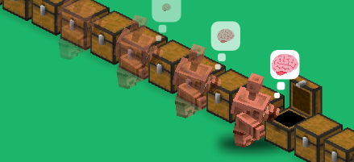
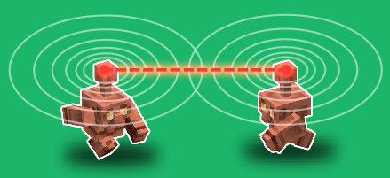

# Copper Golem Patch

Plugin Paper qui donne aux Copper Golems une **mémoire persistante** du contenu des coffres et leur permet de **se la partager** entre eux, pour qu'ils arrêtent de re-vérifier des coffres dont ils savent déjà qu'ils ne conviennent pas.


## Le problème

En vanilla, un golem de cuivre réévalue chaque coffre à chaque passage : il s'y rend, l'examine ~3 s, et repart si le contenu ne correspond pas. Il n'apprend rien. Pire, s'il ramasse un objet qu'aucun coffre n'accepte, il le garde en main indéfiniment et bloque tout le tri.

## Ce que fait le plugin

| Mécanisme | Effet |
|---|---|
| **Mémoire par golem** | Chaque golem retient ce qu'il a vu dans chaque coffre, persisté dans son PDC (survit aux redémarrages). |
| **Gossip** | Deux golems qui se croisent échangent leurs mémoires — un golem connaît des coffres qu'il n'a jamais visités. |
| **Skip informé** | Un coffre connu comme non-conforme est refusé sans déplacement ni examen. |
| **Anti-blocage** | Un objet que personne n'accepte est reposé dans un coffre de cuivre et marqué « insortable », partagé par gossip, avec réessai automatique dès qu'une place se libère. |
| **Dépriorisation** | Si le premier slot d'un coffre de cuivre contient un objet insortable, il est permuté avec le premier objet sortable — sinon il bloquerait tout ce qu'il y a derrière. |




## Compatibilité

| Minecraft | Java requis | Statut |
|---|---|---|
| 1.21.9 | 21 | ✅ |
| 1.21.10 | 21 | ✅ |
| 1.21.11 | 21 | ✅ |
| 26.1.2 | 25 | ✅ |
| 26.2 | 25 | ✅ |

**1.21.9 est le plancher absolu** : c'est la version qui a introduit les Copper Golems, il n'y a rien à patcher avant.

Un **jar unique** couvre toute la plage. Il est compilé contre l'API 1.21.9 et émet du bytecode Java 21, ce qui le rend chargeable aussi bien sur un serveur Java 21 que Java 25. Chaque version de la matrice est recompilée et testée à chaque commit ([CI](../../actions)).

Serveur **Paper** requis (le plugin dépend de `ItemTransportingEntityValidateTargetEvent`, une API Paper) — Spigot et Bukkit ne conviennent pas.

## Installation

1. Récupérer `CopperGolemPatch-x.y.z.jar` depuis les [releases](../../releases).
2. Le déposer dans `plugins/`.
3. Redémarrer le serveur. Le fichier `plugins/CopperGolemPatch/config.yml` est généré avec des valeurs par défaut utilisables telles quelles.

## Commandes

`/cgp` — permission `coppergolempatch.admin` (op par défaut).

| Sous-commande | Effet |
|---|---|
| `/cgp reload` | Recharge `config.yml` à chaud. |
| `/cgp info` | État de la mémoire du golem le plus proche (< 10 blocs) : coffres connus, ancienneté, objets insortables. |
| `/cgp toggle` | Bascule `enabled` et sauvegarde. |

## Configuration

Tous les réglages sont documentés dans [config.yml](src/main/resources/config.yml). Les principaux :

| Clé | Défaut | Rôle |
|---|---|---|
| `enabled` | `true` | Coupe-circuit : `false` rend le comportement vanilla sans désinstaller. |
| `gossip.enabled` | `true` | Partage de mémoire entre golems. |
| `gossip.radius` | `12.0` | Distance max (blocs) pour un échange. |
| `gossip.interval-ticks` | `30` | Fréquence de vérification (20 ticks = 1 s). |
| `memory.max-entries-per-golem` | `32` | Nombre de coffres retenus par golem. |
| `memory.entry-ttl-seconds` | `1800` | Oubli d'un coffre non revu. |
| `give-up.after-rejections` | `50` | Garde-fou sur la longueur d'une recherche. |
| `give-up.unplaceable-ttl-seconds` | `20` | Durée du marquage « insortable » — sert aussi d'horloge de réessai : c'est ce qui permet à un golem bloqué de découvrir un coffre posé après coup. |

## Développement

Build par défaut = build plancher = artefact distribuable :

```bash
./gradlew build
```

Compiler/tester contre une autre version de la matrice :

```bash
./gradlew build -PmcVersion=26.2
```

Lancer un serveur de test (monde isolé dans `run/<version>/`, jamais commité) :

```bash
./gradlew runServer -PserverVersion=26.2
```

Vérifier que le jar plancher charge bien sur un serveur récent — les deux propriétés sont indépendantes :

```bash
./gradlew runServer -PmcVersion=1.21.9 -PserverVersion=26.2
```

> Les mondes ne sont pas rétro-compatibles : un monde ouvert en 26.2 ne se rouvre pas en 1.21.9. C'est pourquoi chaque version a son propre répertoire de run.

### Ajouter une version à la matrice

Une seule ligne à ajouter dans `supportedVersions` de [build.gradle.kts](build.gradle.kts), plus l'entrée correspondante dans la matrice de [ci.yml](.github/workflows/ci.yml). Si la CI passe, la version est couverte sans changement de code.

### Branches

`main` est toujours releasable et protégée. Tout passe par une branche courte (`feat/…`, `fix/…`) et une pull request validée par la CI.

Pas de branche par version de Minecraft : un code source unique couvre toute la matrice, la CI le prouve à chaque commit. Des branches par version dupliqueraient le code sans bénéfice.

### Publier une release

```bash
git tag v0.2.0 && git push origin v0.2.0
```

Le workflow [release.yml](.github/workflows/release.yml) revalide la matrice complète, construit le jar plancher et crée la release GitHub avec le jar attaché.

## Licence

[MIT](LICENSE)
